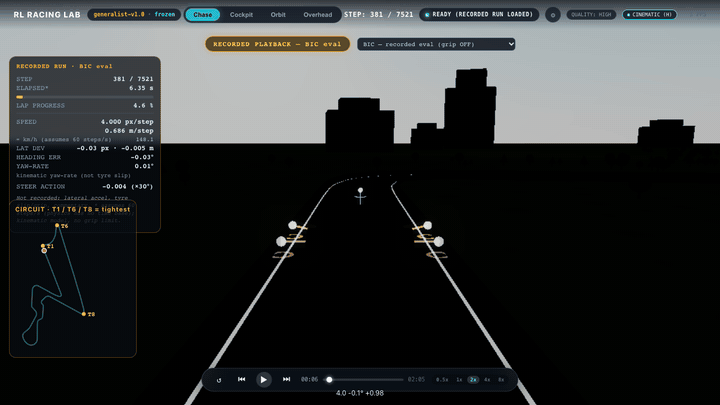

# RL Racing Lab

[](#tests)
[](requirements.txt)
[](LICENSE)
[](https://huggingface.co/spaces/prateekraj91/rl-racing-lab)



*Recorded chase-cam playback of the frozen policy at Buddh International Circuit (steps 380-650, from the real recorded run).*

**Live demo: https://huggingface.co/spaces/prateekraj91/rl-racing-lab** (direct: https://prateekraj91-rl-racing-lab.static.hf.space)

> The public demo is a **static site** (Hugging Face Static Space): recorded BIC / grip-experiment runs plus precomputed deterministic rollouts of the frozen policy for standard-track seeds 1001–1005. It contacts no API. To run the **live API**, use the Docker/local instructions below.

- A frozen SAC policy (`generalist_v1`, 9-dim observation → `[steering, throttle]`) does **path-tracking on real Buddh International Circuit geometry** (OpenStreetMap centerline, 12 m width) — kinematic bicycle model, deterministic inference.
- An **independent engineering audit** corrected several reported figures and documents what the simulator can and cannot claim: [`docs/evaluation/BIC_INDEPENDENT_AUDIT.md`](docs/evaluation/BIC_INDEPENDENT_AUDIT.md).
- **Grip finding:** with a lateral-grip limit of 0.8–1.2 G the policy leaves the track at the first corner at full speed and never brakes (0% braking in every run): [`docs/evaluation/GRIP_LIMIT_EXPERIMENT.md`](docs/evaluation/GRIP_LIMIT_EXPERIMENT.md). Not a claim about real cars — kinematic sim, assumed 12 m = 70 px and 60 steps/s.

The page opens on a recorded BIC playback (chase cam, no compute). A selector switches to the grip-experiment runs (clearly labelled *EXPERIMENT*) and to a precomputed deterministic standard-track rollout (frozen policy, seed picker 1001–1005; in the live API build this mode runs the policy on request). All telemetry is raw simulator output (px, px/step, degrees).

## Benchmarks (frozen `generalist_v1`)

| | Result | Source |
|---|---|---|
| Generalization, 10 unseen tracks (seeds 1001-1010) | **87/110 (79.1%)** deterministic benchmark; standard W=70 **10/10**; corridors W=70...20 px **70/70** (0 crashes); randomized starts **20/20** | `python eval.py` |
| Hairpin pinch sweep | f=0.50 **5/10**, f=0.35 **2/10**, f=0.20 **0/10** (the known limit) | `python eval.py` |
| BIC (real circuit geometry), 1 lap | 7,521 steps, completed, mean lateral dev **0.059 m** (RMS 0.142 m), max 1.00 m, mean speed 3.98 px/step | [BIC audit](docs/evaluation/BIC_INDEPENDENT_AUDIT.md) |
| Grip limit 0.8 / 1.0 / 1.2 G | **0/3 BIC laps**, off-track at Turn 1 at full speed, **0.0% braking** in every run | [grip experiment](docs/evaluation/GRIP_LIMIT_EXPERIMENT.md) |
| Frontend (chase cam, 1280x800) | **59.7 fps** avg high quality (p99 frame 16.8 ms); 59.6 fps low | [`bench.json`](docs/evaluation/bic_playback/bench.json) |
| API memory, 100 rollouts in Docker | flat at ~333 MiB after cache warm-up | [memory check](docs/evaluation/docker_100_lap_memory.md) |

BIC and grip figures are simulator-only (kinematic model, assumed 12 m = 70 px and 60 steps/s) - not claims about real cars. fps was measured in a browser pane on one machine.

## Reproduce the headline eval (fresh clone)

```bash
git clone https://github.com/prateekraj91/RL-Racing-Agent.git && cd RL-Racing-Agent
python3.11 -m venv venv && source venv/bin/activate && pip install -r requirements.txt
python eval.py --weights models/generalist_v1.pth     # ~3 min CPU, read-only
```

Prints per-slice results and checks them against the committed reference (`MATCHES ... YES`).

## Run locally

```bash
python -m venv venv && source venv/bin/activate
pip install -r requirements-inference.txt   # (requirements.txt also works)
PYTHONPATH=. uvicorn inference.app:app --port 8000      # then open http://localhost:8000/demo
```

Docker (CPU, same image as the Space):

```bash
docker build -t rl-racing-lab .
docker run --rm -p 7860:7860 rl-racing-lab               # http://localhost:7860/demo , health: /health
```

Live API image (not used by the static public demo). Optional Gemini commentary is **off by default**; the app needs no API keys. Public hardening: `/simulation/rollout` results are cached by request (deterministic), uncached rollouts are rate-limited per IP (`ROLLOUT_RATE_LIMIT_PER_MIN`, default 20) and `max_steps` ≤ 1000.

## Static build (what the public demo serves)

```bash
PYTHONPATH=. python scripts/build_static.py          # -> dist/  (recorded runs + 5 precomputed rollouts + frontend)
cd dist && python -m http.server 8100                # http://localhost:8100/
scripts/deploy_hf.sh                                 # push dist/ to the Static Space (needs `hf auth login --add-to-git-credential`)
```

## Reproducibility note

Deterministic and bit-reproducible **per platform**; cross-platform rollouts may differ by <0.5 px due to floating-point differences amplified by the saturating policy. Published results are recorded runs.

## Tests

```bash
PYTHONPATH=. pytest -q
```

Tests that need the git-ignored training runs (`runs/ablation_*`) and the browser e2e tests (need `pip install -r requirements-dev.txt`, `playwright install chromium`, and a server on :8000) **skip with a reason** when their prerequisites are absent. Fresh clone: 201 passed, 14 skipped.

## Reports
- **Final report (start here):** [`docs/REPORT.md`](docs/REPORT.md)
- BIC audit: [`docs/evaluation/BIC_INDEPENDENT_AUDIT.md`](docs/evaluation/BIC_INDEPENDENT_AUDIT.md)
- Grip-limit experiment: [`docs/evaluation/GRIP_LIMIT_EXPERIMENT.md`](docs/evaluation/GRIP_LIMIT_EXPERIMENT.md)
- Model card: [`docs/GENERALIST_MODEL_CARD.md`](docs/GENERALIST_MODEL_CARD.md)

Track data © OpenStreetMap contributors, ODbL 1.0.
