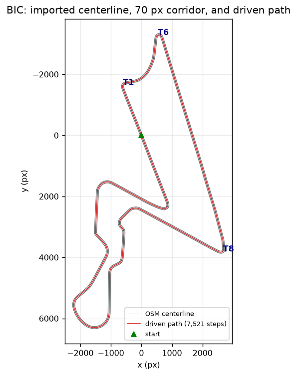
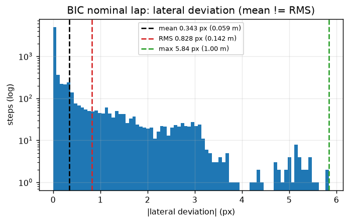
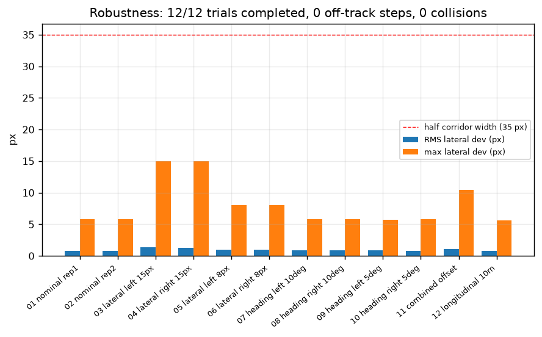
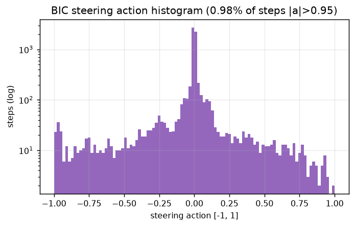
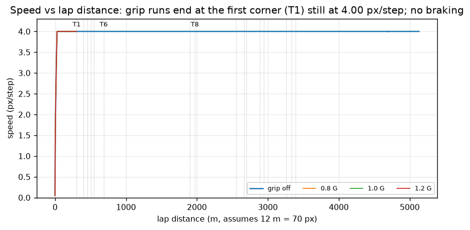

# RL Racing Lab — Final Report

*Frozen policy `generalist_v1` · SAC · kinematic 2D simulator · Buddh International Circuit (BIC) transfer · independent audit · grip-limit experiment*

**Sources.** This report is compiled only from existing repository documents and recorded data (`docs/GENERALIST_MODEL_CARD.md`, `docs/ABLATION_MATRIX.md`, `docs/REWARD_V2_SOLVED.md`, `docs/PHASE_2_REPORT.md`, `docs/evaluation/BIC_INDEPENDENT_AUDIT.md`, `docs/evaluation/GRIP_LIMIT_EXPERIMENT.md`, `analysis/buddh/*.csv`, `runs/grip_eval/*.csv`). No new experiments were run. Figures are regenerated from the recorded CSV/NPZ files by `scripts/make_report_figures.py`.

**Units.** Primary units are **px/step** and **m/step**. The simulator physics has no time base (§5), so km/h appears only with the explicit qualifier *"assumes 60 steps/s"*. Length conversion uses the BIC importer's width calibration, 12 m = 70 px (1 px = 0.1714 m); at the 4.0 px/step speed clamp this is 0.686 m/step.

---

## 1. Summary

1. A Soft Actor-Critic policy (`generalist_v1`, 9-dim observation → 2-dim action), trained with calibrated domain randomisation on 25 procedural tracks, generalises to held-out procedural tracks (100% completion on standard and narrow corridors) and completes a 5.13 km OpenStreetMap-derived Buddh circuit with 0 off-track steps, 0 collisions and 12/12 robustness trials completed — as a kinematic path-follower at full throttle.
2. An independent audit found the original BIC write-up wrong on four counts (a corner "speed" that was a launch transient, a mean/RMS mix-up, an "8-feature" observation, and the absence of any grip model); the corrected figures are used throughout this report.
3. A grip-limit experiment shows the policy is not physically robust: with lateral grip capped at 0.8–1.2 G it leaves the track at the first corner at the full 4.00 px/step with 0% braking, so the BIC result cannot be read as evidence of real-car driving skill.

---

## 2. System

### 2.1 Environment
`RacingEnv` (`env/`) is a 2D kinematic bicycle model: wheelbase 50 px, steering ±30°, speed clamp 4.0 px/step, throttle-dependent acceleration minus friction. `Car.dt = 1/60` is declared but cancels in every use (`* dt * 60`), so velocity is natively **px/step** (audit Q11). Tracks are procedural splines (width, base radius, control-point count, minimum radius) or, for BIC, an imported centerline. Episodes end on lap completion (accumulated `lap_progress ≥ 1.0`), crash/off-track, or timeout. Frozen-contract rule: no physics change in `env/` was made for any result here; the optional `grip_limit` flag (default off) pre-existed and is used only by the grip experiment.

### 2.2 Observation (9-dim) and action (2-dim)
| idx | channel | note |
|---|---|---|
| 0 | forward velocity (px/step) | |
| 1 | heading error vs. nearest tangent (deg) | |
| 2 | signed centerline distance (px) | |
| 3 | slip | computed during `step()`, but equals −Δheading (a yaw-rate echo, not tyre slip; §5) |
| 4–8 | rangefinders at −90°, −45°, 0°, +45°, +90° | 200 px max range |

Action: `[steering, throttle] ∈ Box(−1, 1)²`; steering maps linearly to ±30°. Inference is deterministic: `tanh(mean)` of the actor, no sampling.

### 2.3 Algorithm and training
Continuous SAC with automatic entropy temperature; actor MLP 9→128→128→(mean, log_std)×2, 18,308 parameters (as reported by `/health`). Documented training history:

- **Exploration trap.** From a random-warmup start the agent froze at v = 0 (a safe local optimum; crash penalty −20 vs 0 for standing still) for 105k steps. Reward re-tuning did not fix it; **seeding the replay buffer with 40 pure-pursuit demonstration laps** solved the medium track at step ~5,000 across 4 seeds (`REWARD_V2_SOLVED.md`).
- **Single-track baseline** (seed 101, 45k steps) completes its own track but overfits (below).
- **Final recipe** (Run A of a 2×2×2 factorial ablation): 25 training tracks, calibrated domain randomisation (width 25–70 px, min radius 65–95, friction, acceleration), 200 px ray lookahead, steering-smoothness penalty β = 0.01, 200k steps.

### 2.4 Frozen-artifact process
`models/generalist_v1.pth` and `configs/generalist_v1.json` are frozen and their SHA-256 hashes are verified at the end of every task. Final-check result for this report is in §9.

### 2.5 API and tests
FastAPI service in `inference/` loads the frozen weights with strict integrity checking and the same `SACActor` class as training (parity is a stated contract; the audit re-confirmed `obs_dim = 9`, `tanh(mean)`, strict weight load, no normalisation). Endpoints: `/health`, `/predict`, `/predict/batch`, `/simulation/{tracks,start,step,rollout,reset,state}`, `/simulation/historical-saliency`, `/recorded/bic`; API changes are additive-only. `/simulation/rollout` is cached by request, rate-limited per IP and capped at 1000 steps. The public demo is a static Hugging Face Space serving recorded BIC/grip runs and precomputed seed 1001–1005 rollouts (no live API). The `tests/` suite covers the model contract, API, recorded BIC data, importer, grip-eval data and static build; targeted test results are in §9.

---

## 3. Training and generalisation results

All numbers below are deterministic evaluations on held-out procedural tracks (`TEST_SEEDS` 1001–1010) from `GENERALIST_MODEL_CARD.md` and `ABLATION_MATRIX.md`. Lap times are in **steps**.

| Policy | Standard (W = 70) | Narrow corridors (W = 20 … 70) | Pinched hairpins (f = 0.50 / 0.35 / 0.20) |
|---|---|---|---|
| Single-track baseline v2 | 100%, 398.9 steps | 60% at W = 20 (504 steps, crashes/timeouts) | 0% |
| Run E (no DR) | 100%, 395.0 | 100%, but 435.6 steps at W = 20 | 7/10, 2/10, 0/10 |
| Run C (300 px lookahead) | 100%, 397.8 | 100% | 0/30 (all crash) |
| Run B (no steering penalty) | 100%, 397.4 | 100% | 0/30 (23 wandering timeouts) |
| **`generalist_v1` (Run A)** | **100%, 398.2** | **100% (70/70), 394.6 steps at W = 20** | **5/10, 2/10, 0/10** |

Further results for the frozen policy: **20/20 completion from perturbed start poses** (heading ±15°, initial speed 0–4 px/step) and **zero outcome/step-count differences across 3 repetitions of 110 deterministic episodes** (bit-for-bit with the historical ablation record). The factorial analysis attributes the narrow-corridor robustness to domain randomisation and the hairpin ability to the combination of 200 px lookahead and the steering penalty.

Honest limits of this section: hairpin success is partial (7/30 overall; 0/10 at the extreme pinch), and all results are on this simulator's procedural tracks.

---

## 4. Transfer to the Buddh International Circuit

### 4.1 OSM import pipeline (`buddh/importer.py`)
1. Raw OpenStreetMap relation 2532569 (ODbL 1.0), retrieved 2026-11-20, stored offline in `data/osm/`; 6 mainline way IDs assembled, **pit lane excluded by construction**.
2. Exact WGS84 → UTM zone 43N transverse-Mercator projection.
3. Closed centripetal Catmull-Rom spline (α = 0.5), uniform **1 m** arc-length resample → 5,131 points.
4. Constant corridor width 12 m = 70 px (**5.833 px/m**), boundaries offset from the centerline; 16 turns detected (T1 r = 18.9 m at 304 m; tightest r = 14.35 m).
5. Length: resampled 5,131.0 m vs published 5,138.0 m (0.14% short). Geometry validation and the manifest are committed (`buddh/`).

*Figure 1. Imported BIC centerline, 70 px corridor and the driven path of the nominal frozen-policy lap.*

### 4.2 Results (corrected metrics, from `BIC_INDEPENDENT_AUDIT.md`)
| Quantity | Value |
|---|---|
| Termination | `lap_completed` after **7,521 steps**; 0 crashes, 0 off-track steps |
| Mean / max speed | **3.979 / 4.000 px/step** (0.682 / 0.686 m/step) — the max is the speed clamp |
| Mean lateral deviation | **0.343 px = 0.059 m** |
| RMS lateral deviation | 0.828 px = 0.142 m |
| p95 / max lateral deviation | 2.107 px (0.361 m) / 5.845 px (1.002 m) |
| Heading error mean / RMS / max | 0.395° / 1.053° / 12.5° |
| Braking steps | **0 of 7,521** (min throttle +0.2745, mean 0.978) |
| Determinism | bitwise-identical across repetitions |
| Equivalent speeds *(assumes 60 steps/s)* | 147.3 km/h mean, 148.1 km/h max |

*Figure 3. Distribution of |lateral deviation| over the nominal lap (log count). The mean (0.059 m) and RMS (0.142 m) are different quantities.*

### 4.3 Robustness (12 trials, `analysis/buddh/robustness_summary.csv`)
Nominal ×2 (bitwise identical), lateral offsets ±8 px and ±15 px, initial heading ±5° and ±10°, one combined offset (+10 px, −5°), and a +10 m longitudinal start offset. **All 12 completed**, 7,520–7,522 steps each, **0 off-track steps and 0 collisions**. RMS lateral deviation 0.142–0.227 m; the larger maxima in the offset trials (up to 2.571 m) are the imposed starting offsets themselves. Caveat: lap completion is distance-accumulated (a full loop of travel), so step count is insensitive to start offset by construction.

*Figure 5. RMS and maximum lateral deviation for the 12 perturbation trials, against the half-width of the corridor (35 px).*

### 4.4 Steering behaviour

*Figure 4. Steering action histogram for the nominal lap: most steps are near zero; 0.98% of steps are saturated (|a| > 0.95) with heavy tails toward both locks.*

Steering reaches full lock (max |a| = 0.9998) and changes by up to 47°/step at corners, so a bang-bang component is present, but the average is calm on BIC's long straights (mean steering change 1.64°/step, versus ~10.7°/step cited for standard tracks).

---

## 5. The audit: what was wrong in the original report, and why

The audit (`BIC_INDEPENDENT_AUDIT.md`, 2026-11-23) recomputed every figure from the committed 7,521-row rollout and read the ground-truth code. **Scope note:** the original `buddh_evaluation_report.md` is not present in the working tree or git history, so its claims were compared via the pre-audit's quotations; the committed CSV/JSON data themselves are internally consistent.

| # | Original claim | What the data/code show | Root cause |
|---|---|---|---|
| 1 | "Slowed to 56.16 km/h at Turn 3" | 56.16 is `min(speed[30:])` at step 31 (distance 4.2 m) during **launch spin-up**. The car holds 4.0 px/step through *every* corner, including the detected T3 (d = 454 m, r = 96.4 m), and never brakes | **Time base / label error**: a launch transient reported as a corner speed; the "speed-modulation" narrative had no support |
| 2 | Mean lateral deviation 0.142 m | Mean is **0.059 m**; 0.142 m is the **RMS** | **Mean vs RMS**: the RMS value was copied into the mean field |
| 3 | "8-feature" observation | Contract is **9-dim** (checked in `RacingEnv`, `eval_buddh`, `inference/schemas.py`) | Heading error was dropped from the written list |
| 4 | Implicitly physical cornering | Lateral acceleration v²/r is **9.1 G (T1), 11.4 G (T6), 12.0 G (T8)** at 4.0 px/step; F1 peaks ≈ 5–5.5 G; implied wheelbase 8.57 m | **No grip model**: `grip_limit=False` by default, so lateral acceleration is unbounded |

Underlying methodological points the audit established:

- **No time base.** `dt` cancels in the integrator, so every m/s and km/h value rests on an *unenforced* assumption of 60 steps/s. This is why speeds here are px/step first.
- **Slip channel.** Slip is not hard-coded to 0 during the rollout (it is 0 only in `reset()`); but it equals −Δheading exactly (correlation 1.000), so it is a yaw-rate echo carrying no tyre-dynamics information. This also corrects the *pre-audit*, which had said slip was "hardcoded 0.0 every step". Training and evaluation use the same `RacingEnv.step`, so there is no train/eval mismatch. (The model card's wording for `s[3]` pre-dates this finding.)
- **Rangefinders** saturate on a 70 px corridor, so the reward's corner-aware speed penalty is effectively constant — consistent with the 0% braking.
- **Robustness labels** (trials 03–10) in the committed data are correctly labelled; any inversion was in the absent report table.

---

## 6. Grip-limit experiment

Branch `exp/grip-limit` (never merged); script `scripts/grip_eval.py`; outputs `runs/grip_eval/`. The frozen policy was evaluated, without retraining, with the pre-existing opt-in grip clamp (`Car.grip_limit`): if v²/r exceeds `max_grip`, the turn radius is widened (pure understeer; no speed scrub, no slide state). Under the stated assumptions (12 m = 70 px, 60 steps/s) **1 G = 0.01589 px/step²**; tested 0.8, 1.0 and 1.2 G. The grip-off BIC run is byte-identical to the original rollout CSV.

| Track | Grip | Laps | Steps | Off-track at | Speed at failure | Braking |
|---|---|---|---|---|---|---|
| BIC | off | 1 | 7,521 | — | 4.00 px/step | 0.0% |
| BIC | 0.8 G | 0 | 484 | 301.0 m, **T1** | 4.00 px/step | 0.0% |
| BIC | 1.0 G | 0 | 484 | 301.1 m, **T1** | 4.00 px/step | 0.0% |
| BIC | 1.2 G | 0 | 485 | 301.9 m, **T1** | 4.00 px/step | 0.0% |
| Standard, 5 seeds | off | 5/5 | 387–406 | — | — | 0.0% |
| Standard, 5 seeds | 0.8 / 1.0 / 1.2 G | 0/5 each | 77–101 | first ~130–230 px | — | 0.0% |

*Figure 2. Speed vs lap distance (corner apex distances dotted; T1, T6, T8 labelled). Grip-limited runs end at T1 at the full speed clamp; the grip-off run (drawn beneath, 5.13 km) never slows. Distances use 12 m = 70 px.*

Reading: T1 at 4.0 px/step demands ~9–11.6 G; at 0.8–1.2 G the corner would allow roughly one third of the speed the policy carries (12.2–14.9 m/s, using the same assumptions). The policy does not slow even while visibly failing; the three grip levels are indistinguishable (±1 m) because all are far below what the corner needs. Only the first off-track event is observed (the episode terminates), so later corners under grip are untested.

---

## 7. Limitations

**(a) Demonstrated (supported by recorded data).**
- Deterministic, reproducible lap of imported BIC geometry: 7,521 steps, 0 crashes/off-track steps, mean lateral deviation 0.059 m, max 1.002 m.
- 12/12 start-perturbation trials complete; generalisation to held-out procedural tracks incl. narrow corridors (70/70 at W = 20–70).
- Failure under any tested grip cap, at the first corner, at full speed, with 0% braking.

**(b) Reproducible.** Importer, evaluation and inference are offline and deterministic (`tanh(mean)`); every figure here recomputes from committed CSVs; bit-reproducible *per platform* (cross-platform rollouts may differ by < 0.5 px, per the README). SACActor ↔ FastAPI parity holds. The one gap: the original BIC report text is absent, so its table cannot be re-verified.

**(c) Physically unrealistic.**
- 9–12 G cornering with no friction circle; 8.57 m implied wheelbase (car size and 12 m width are not scaled by the same intent).
- 0% braking at full throttle through 14–19 m-radius corners.
- A slip channel that is a yaw-rate echo, not sideslip.
- Speeds in SI units that depend on an unenforced 60 steps/s.
- Grip clamp is understeer-only (no speed scrub or slide), constant corridor width, pit lane excluded, lap completion by accumulated distance rather than a timed line.

**(d) Cannot be claimed.**
- Anything about real lap times, real speeds, tyre or grip behaviour, braking skill or race-car dynamics; no sim-to-real transfer is supported.
- That the policy has learned corner-speed management. As evaluated, it behaves as if cornering speed is unconstrained; we make no claim about its internal representation.
- That grip-aware training would fix this (untested), or that the 0.8–1.2 G levels represent a specific vehicle (they are illustrative, under the stated assumptions).

---

## 8. Future work

1. **Grip-aware retraining with a braking incentive.** Enable the grip limit (or randomise it) during training and add an explicit incentive to slow for corners, since the current reward gives no braking signal (side rays pin `min_ahead`, making the corner-speed penalty effectively constant). Outcome unknown; this is a hypothesis motivated by §6.
2. **A real time base, then a tyre model.** Make `dt` effective in the integrator so SI units are enforced, scale the car and track consistently, and replace the kinematic understeer clamp with a tyre/slip model so the slip observation carries genuine information. This changes physics and observation semantics, so it requires a new versioned policy and environment rather than modifying the frozen artifacts.

---

## 9. Verification

- **Frozen hashes (checked after writing this report):** `models/generalist_v1.pth` = `0d40dc47…b76784` ✅ and `configs/generalist_v1.json` = `4d76575b…3d63bdb1` ✅ — both match the expected values.
- **Targeted tests:** `PYTHONPATH=. pytest -q tests/test_generalist_v1.py tests/test_inference_api.py tests/test_recorded_bic.py tests/test_buddh_importer.py tests/test_grip_eval_recorded.py tests/test_static_build.py` → **43 passed**.
- **Full suite** (`PYTHONPATH=. pytest -q`, API up on :8000): **219 passed**.
- Figures regenerate with `python scripts/make_report_figures.py`.

---

*Track data © OpenStreetMap contributors, ODbL 1.0.*
