# Visual gap report — concept reference vs. current `/demo`

**Target:** `docs/concept_reference/` (Three.js r170 concept render).
**Current:** `frontend/` served at `/demo` (Three.js r128), captured 2026-11-22 while the
frozen `generalist-v1` rollout played, viewport 1920×1080.

App screenshots live in `docs/visual_gap_assets/`. Concept stills are in
`docs/concept_reference/frames/`. No code was changed to produce this report.

> **How to read this:** the overlay/HUD layer (top bar, telemetry sidebar, engineer card,
> rangefinder chips, playback bar) is already a close match to the concept — that work is
> largely done in `frontend/index.html` + `styles.css`. **Almost every gap below is in the
> 3D scene** (`frontend/app.js`): colour grading, sky/fog, lighting, materials, scenery
> placement, and camera framing.

---

## 0. Scene-wide issues (visible in every 3D frame — fix these first)

These five set the entire look and explain most of the per-frame differences. They come
straight from the renderer/scene config, and the concept's values are known exactly:

| # | Area | Concept (`main.js`) | Current (`app.js`) | Effect of the gap |
|---|------|---------------------|--------------------|-------------------|
| G1 | **Exposure / tone map** | ACESFilmic, `toneMappingExposure = 0.62` | ACESFilmic, `exposure = 1.0` (`app.js:137`) | App is ~60% over-exposed: milky sky, washed colours, no black point. |
| G2 | **Sky** | `three/addons/Sky` physical scattering + PMREM env map, `environmentIntensity 0.55` | Flat gradient / HDRI attempt, bright white horizon | Concept sky is a saturated blue dome with soft clouds; app horizon blows out to white. |
| G3 | **Fog** | `Fog(0xa9c4de, 3000, 11000)` — far, pale blue | `Fog(0x9bc2e0, 1400, 4200)` (`app.js:120`) | App fog starts ~2× closer and ends ~2.6× closer, so mid-distance scenery dissolves into grey haze (the "floating faint buildings" look). |
| G4 | **Key light + shadows** | `DirectionalLight(0xfff1dc, 3.2)`, fixed sun azimuth, `PCFSoftShadowMap`, tight 320-unit shadow cam | `DirectionalLight(0xfff8ee, 1.20)` (`app.js:234`) | Concept has a warm, strong sun and crisp contact shadows; app is dim and flat with weak shadowing and no clear sun direction. |
| G5 | **Ground** | Procedural grass canvas texture, `repeat(140,140)`, base `#56763a` | `MeshStandardMaterial` grass, little visible texture, desaturated | Concept lawn is saturated and textured to the horizon; app grass reads as flat pale green-grey. |

---

## 1. `ref_2.5s` — Title / hero 3-quarter (car + start gantry)

<table><tr>
<td><b>Concept</b> 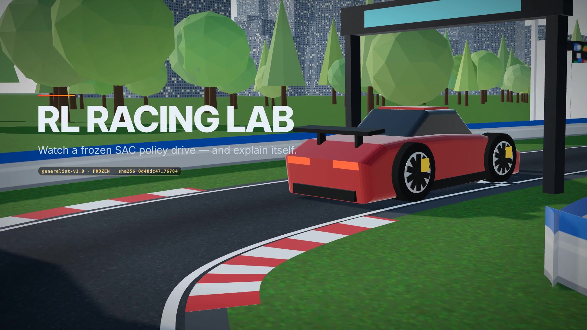</td>
<td><b>Current (closest: orbit)</b> 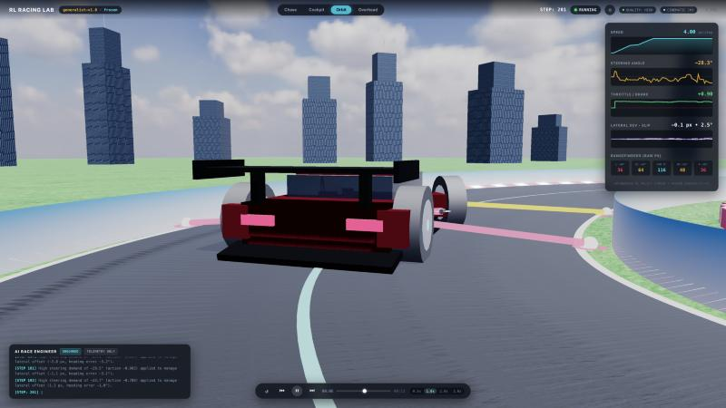</td>
</tr></table>

1. **Car paint reads maroon/near-black, not red.** Concept body is a bright clearcoat red
   (`0xb3150e`, clearcoat 0.6); app paint is dark and muddy under the weak key light (G4).
2. **Brake lights / side detail glow hot magenta-pink** in the app instead of red
   (`emissive 0xff1a12` in concept). The emissive hue/intensity is wrong.
3. **No start gantry in view.** Concept hero is framed under the dark gantry + cyan EMrad
   panel + checker start line; app has no gantry built near the start pose.
4. **Rim/wheel contrast lost.** Concept has bright machined rims (`metal 1, rough .25`) with
   yellow calipers that pop; app wheels are dark and low-contrast.
5. **Flat lighting kills the 3-quarter form.** Concept's single warm sun + soft shadow gives
   the car volume; app's even fill makes it read as a flat shape.

---

## 2. `ref_7s` — Chase cam, city skyline + forest

<table><tr>
<td><b>Concept</b> 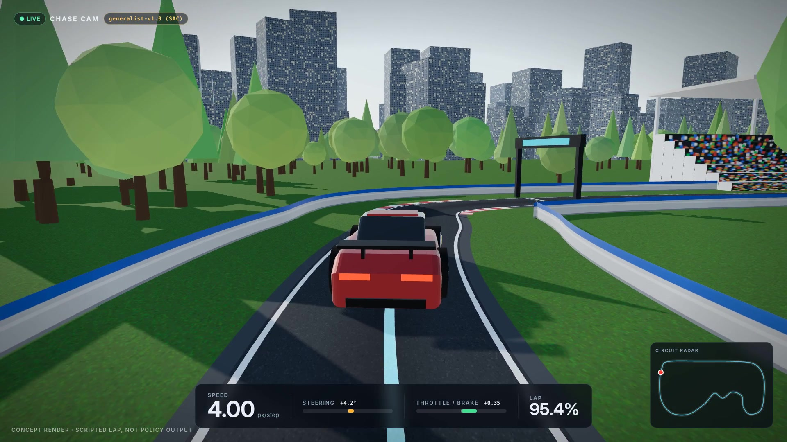</td>
<td><b>Current (chase)</b> 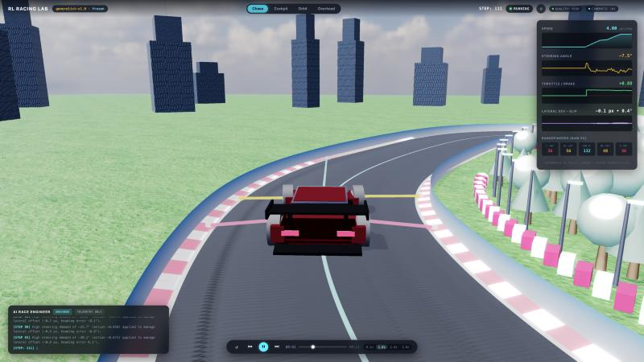</td>
</tr></table>

1. **Buildings are dark navy monoliths that float in haze.** Concept skyline is pale
   blue-grey windowed towers (`winTex`), grounded and dense as a continuous backdrop; app
   towers are too dark, too few, over-spaced, and cut off at the base by near fog (G3).
2. **Curbs render pink/magenta instead of red+white.** Concept `curbTex` is `#d8231d` red
   over white; app curbs read as saturated pink — same emissive/colour bug as the brake
   lights.
3. **Trees are darker and sparser, and some pick up a pink tint** near the curbs. Concept
   trees are lush 2-tone low-poly spheres/pines in full clusters.
4. **Grass desaturates to pale mint by mid-distance** (G3+G5); concept stays a rich green all
   the way to the treeline.
5. **No warm sun / shadow direction.** Concept casts long tree and car shadows across the
   track; app scene is flatly lit with faint shadows.

---

## 3. `ref_11s` — Chase cam, main straight + grandstand

<table><tr>
<td><b>Concept</b> 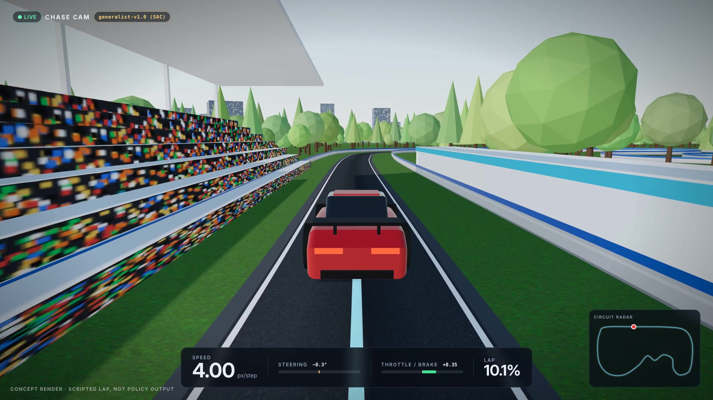</td>
<td><b>Current (chase)</b> </td>
</tr></table>

1. **No grandstand / crowd / pit building.** Concept straight is lined with a tiered
   `crowdTex` grandstand, white roof, and a pit building with a cyan light band; the app has
   none of these alongside the straight.
2. **Armco barrier is faint and washed.** Concept walls are solid white concrete with a
   racing-blue top stripe (`armcoTex`) that reads crisply; app barriers fade into the fog.
3. **Sky is overbright and cloudless-white** vs. concept's blue sky with soft cloud banding.
4. **Centre racing-line / lane markings are low-contrast.** Concept has a bright blue racing
   line and clean white edge lines; app markings are muted by the exposure (G1).
5. **Track surface is grey, not asphalt.** Concept asphalt has grain + a rubbered-in dark
   racing line (`asphaltTex`); app road is a flat mid-grey.

---

## 4. `ref_16.5s` — Lab chase (curbs, sensor beams, telemetry panel)

<table><tr>
<td><b>Concept</b> 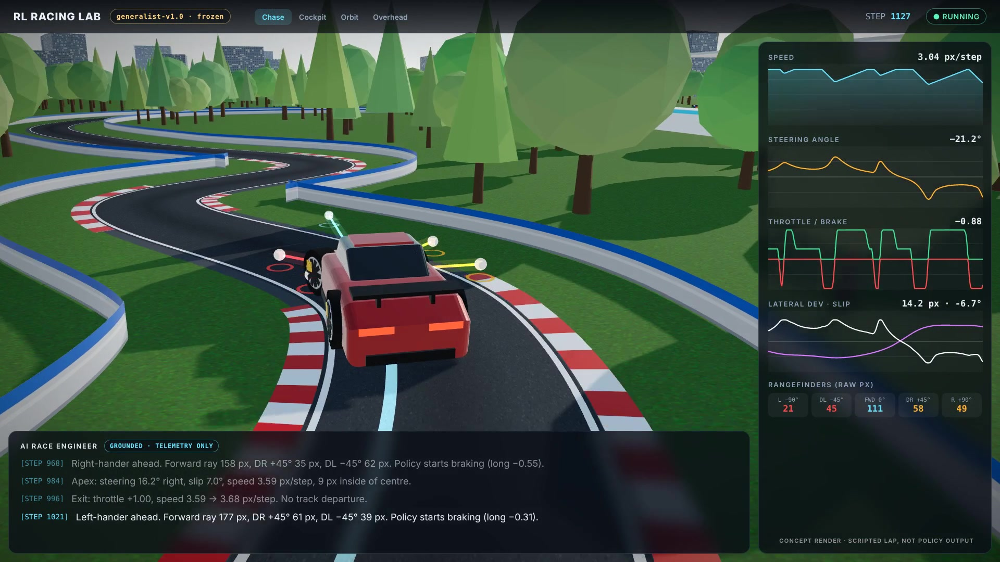</td>
<td><b>Current (chase + orbit for sensors)</b> </td>
</tr></table>

1. **Sensor beams/labels are magenta and not clearly colour-coded.** Concept rays are
   cyan→amber→red by distance (`rayCol`), with white hit spheres + rings on the boundary; app
   beams read as flat pink lines without the hit markers or distance colour tiers.
2. **Curbs pink again** where concept shows red/white curbs through the esses.
3. **Telemetry panel content is sparser/flatter.** The concept sidebar charts are filled and
   high-contrast (cyan speed fill, amber steering, green/red throttle, purple lat-dev); app
   panel is darker and the traces are thin/low-contrast (overlay styling is close, but line
   rendering differs).
4. **Depth falls apart past the first corner.** Concept keeps the winding ribbon and far
   barriers legible into the distance; app loses them to near fog (G3).
5. **Overall scene is muddy green-grey** vs. the concept's saturated grass + warm sun — same
   grading gap (G1/G4/G5).

---

## 5. `ref_22s` — Sensor view (elevated 3-quarter, ray fan)

<table><tr>
<td><b>Concept</b> 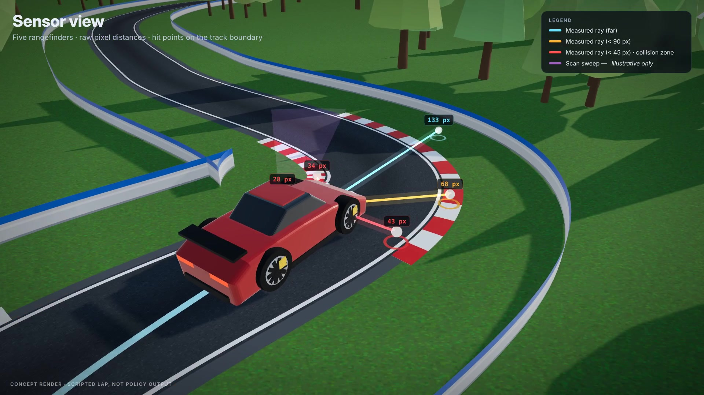</td>
<td><b>Current (closest: orbit)</b> </td>
</tr></table>

1. **No dedicated elevated "sensor view" framing.** Concept uses a slow high 3-quarter orbit
   that shows all five rays fanning to the boundary; the app's orbit sits low and close behind
   the car, so the ray fan and hit points aren't showcased.
2. **Hit spheres + distance labels + hit rings are missing/weak.** Concept pins a `NNN px`
   chip and a glowing ring at each boundary hit; app shows bare coloured lines.
3. **Scan-sweep wedge absent.** Concept has the translucent purple illustrative sweep arc;
   not present in the app.
4. **Ray colours wrong** (pink vs. cyan/amber/red tiers) — same `rayCol` mismatch as §4.1.
5. **Car paint/rims still dark** under flat light, so the hero car in this beauty shot lacks
   the concept's punch.

---

## 6. `ref_27.5s` — Real-world import (OSM map wipe, early stage)

<table><tr>
<td><b>Concept</b> 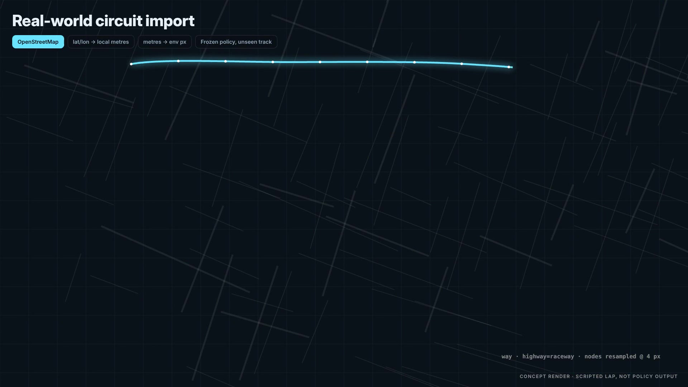</td>
<td><b>Current (no equivalent captured)</b> <i>app has no OSM map-wipe stage in the live demo</i></td>
</tr></table>

1. **No OpenStreetMap canvas-wipe sequence.** Concept draws a dark `#0b1118` map with a grid,
   scattered faint "roads", then traces the centreline in glowing cyan with node dots and a
   `way · highway=raceway` caption. The app demo has no such transition.
2. **No pipeline step chips animating** (`OpenStreetMap → lat/lon → metres → env px → frozen
   policy`) over a map stage.
3. **No "metres → env px" reveal** tying the OSM trace to the in-engine track.
4. **No import info panel** (`METRES_PER_PX`, length, min radius, corridor width) shown during
   this stage.
5. This is a **whole missing scene**, not a grading gap — flag as a feature to port, not a
   tweak. (Any numbers shown must come from a real import, never `sim.js`.)

---

## 7. `ref_33s` — Real-world import, populated overhead

<table><tr>
<td><b>Concept</b> 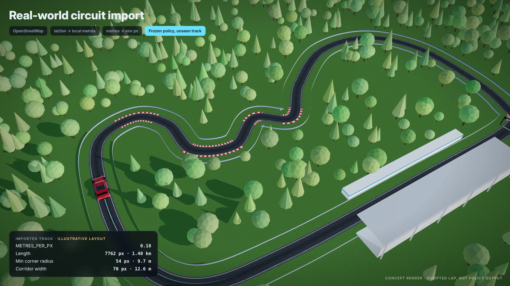</td>
<td><b>Current (overhead)</b> 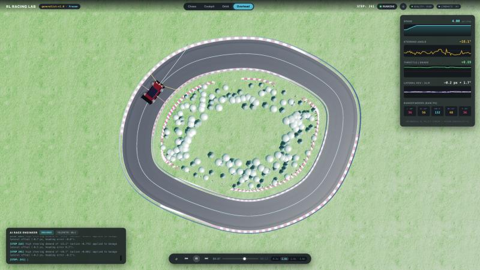</td>
</tr></table>

1. **Trees are crammed INSIDE the track loop and render white.** This is the biggest single
   defect: the app fills the infield with hundreds of white/un-tinted blobs. Concept keeps the
   infield **open green** and scatters trees **outside** the ribbon (`trackDist > 150` filter);
   its leaves are green via per-instance `setColorAt`. The app's instance colouring/placement
   is broken.
2. **Tree foliage colour is unset (white).** Concept tints each tree with an HSL green ramp;
   app leaves show as flat white — the `setColorAt` tint isn't being applied.
3. **No pit building / grandstand** along the straight (concept shows the long white pit
   structure); app overhead has bare track.
4. **Grass is pale and flat**, no texture or saturation variation (G5); concept lawn is deep
   green with soft tree shadows.
5. **Curbs read correctly red/white from directly overhead** but turn pink at grazing angles
   in the 3D cams — confirming the issue is emissive/material, not the texture itself.

---

## 8. `ref_39.5s` — Post-lap analysis modal

<table><tr>
<td><b>Concept</b> 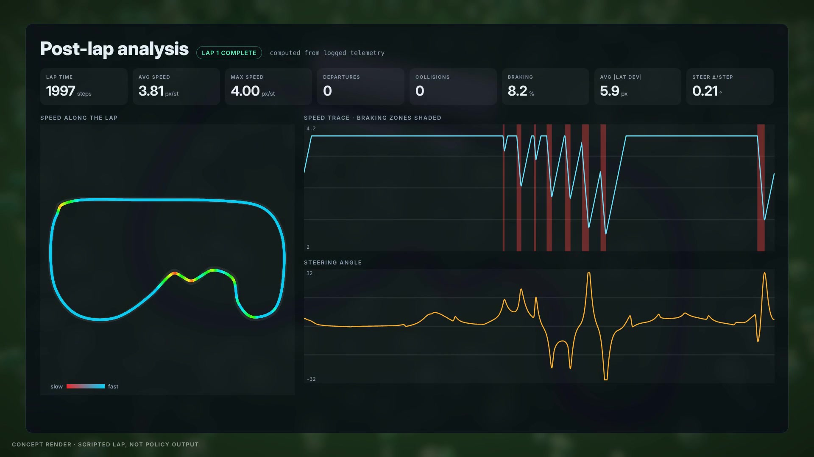</td>
<td><b>Current (modal in DOM, not shown live)</b> <i>see <code>#canvasOverlay</code> in index.html</i></td>
</tr></table>

1. **Layout already matches** — KPI tile row, speed-along-lap map, speed trace with shaded
   braking zones, steering trace. This panel is in good shape (`frontend/index.html:265+`).
2. **Speed-map colour gradient** (red→cyan `slow→fast`) must be driven from **real logged
   telemetry**, not the scripted lap — verify the live modal renders from the rollout, not
   placeholder numbers.
3. **Braking-zone shading** on the speed trace should mark real `long < 0` steps.
4. **Background blur/vignette** — confirm the live modal dims the scene behind it as the
   concept does.
5. **Minor:** confirm KPI values (lap steps, avg/max speed, departures, collisions, braking %,
   lat dev, steer Δ) are computed from the frozen policy's logged lap.

---

## 9. Concept `main.js` functions that port almost directly

These are art-direction / scene-building only — safe to port into `frontend/app.js` /
`world.js` with no touch to env physics, the obs/action contracts, or the frozen policy.
Telemetry stays raw; `sim.js` numbers are never used.

| Concept feature | Where in `main.js` | Port difficulty | Notes |
|---|---|---|---|
| **Sky (physical scattering)** | `Sky` + uniforms `main.js:25-31` | Easy | Needs `three/addons/Sky` (r128 app must vendor it or upgrade three). Biggest single visual win. |
| **PMREM environment** | `main.js:32-35` | Easy | Soft image-based lighting; pairs with the Sky. |
| **Exposure + ACES** | `main.js:15-17` | Trivial | Set `toneMappingExposure = 0.62`. One line. |
| **Fog** | `main.js:36` | Trivial | Use `Fog(0xa9c4de, 3000, 11000)`; the current near fog is the main "haze" culprit. |
| **Sun + soft shadows** | `main.js:38-44` | Easy | Warm directional `3.2`, fixed azimuth, `PCFSoftShadowMap`, 320-unit shadow cam, hemisphere fill. |
| **Procedural textures** | `canvasTex` + asphalt/grass/curb/armco/window/crowd `main.js:47-77` | Easy | Pure canvas 2D; drop-in. Fixes grass, asphalt grain, curb red/white, window + crowd looks. |
| **`ribbon()`** | `main.js:80-107` | Medium | Builds runoff margin, asphalt, edge lines, and **curvature-based curbs** from track points. Clean port target for the road stack. |
| **`wall()` (Armco)** | `main.js:108-136` | Easy | White concrete + blue-stripe barrier both sides. |
| **Curbs (curvature-gated)** | `corner` filter + `ribbon(...curbMat)` `main.js:130-133` | Easy | Only curbs the corners, like the concept. |
| **Start gantry + checker line** | `main.js:138-150` | Easy | Posts, beam, emissive cyan panel, checker start — needed for the hero/title frame. |
| **Instanced trees (placement + green tint)** | `main.js:152-175` | Medium | **Port the `trackDist > 150` keep-out and the per-instance `setColorAt` green ramp** — this directly fixes the white-blobs-in-infield defect (§7). |
| **Skyline buildings** | `main.js:176-188` | Easy | Windowed towers as a far ring + back cluster; fixes the dark floating-tower look. |
| **Grandstand + pit building** | `main.js:189-204` | Easy | Tiered crowd stand, roof, pillars, pit block + cyan band along the main straight. |
| **Sensor beams + glow + hit rings + `rayCol`** | `main.js:252-272, 286-300` | Medium | Cyan/amber/red distance tiers, hit spheres, boundary rings. Fixes the pink-rays bug. Drive from **real** rangefinder telemetry. |
| **Scan-sweep wedge** | `main.js:262-263, 415` | Easy | Illustrative purple arc for the sensor view. |
| **Trail ribbon** | `main.js:264-270, 302-312` | Medium | Additive fading cyan trail behind the car. |
| **Chase / sensor / overhead camera rigs** | `SCENES.*.frame` `main.js:373-422` | Medium | Lagged-heading chase, elevated sensor orbit, overhead framing — improves the camera framing gaps (§2, §5). |
| **OSM import map-wipe + pipeline chips** | `SCENES.rw` `main.js:423-453` | Hard | Whole missing scene (§6). Canvas map, centreline trace, step chips, info panel. Build as an additive stage. |
| **Car build (body/cab/wing/wheels)** | `main.js:206-249` | Medium | Already approximated in-app; the concept's physical paint + rim materials are the quality reference. Fixing light + emissive (G4, §1.2) may matter more than re-modelling. |

### HUD / CSS (already close — keep, don't rebuild)
`index.html` glass panels, chips, HUD strip, lab sidebar charts, sensor legend, rangefinder
chips, real-world info panel, and post-lap tiles already mirror `concept_reference/index.html`.
Treat these as done; focus effort on the 3D scene above.

---

## 10. Priority order (suggested)

1. **Grading foundation** (G1–G5): exposure, Sky, fog, sun+shadows, grass texture. One pass,
   transforms every frame.
2. **Colour bug fixes**: curbs + brake lights + sensor rays (the pink/magenta issue) and the
   **white-trees-in-infield** placement/tint bug.
3. **Missing scenery**: skyline buildings (grounded), grandstand + pit, start gantry.
4. **Sensor-view polish**: hit rings, labels, scan sweep, ray colour tiers, elevated framing.
5. **Feature scenes**: OSM real-world import stage; verify post-lap modal runs on real
   telemetry.

Every change above goes through `frontend/world.js` / `app.js` only, keeps telemetry raw, uses
no `sim.js` numbers, and leaves the env + frozen policy untouched.
